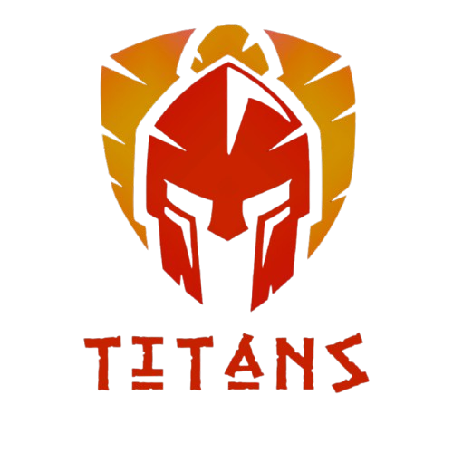

# Rover

  

---

## Sobre

Repositório destinado à documentação dos rovers da Equipe Titans.

## Como contribuir

O padrão de branches, commits, issues e pull requests está no [Guia de Contribuição](CONTRIBUTING.md).

## Licença

Este projeto é distribuído sob a licença [GNU GPL v3](LICENSE).

---

## Histórico de Versões

| Versão | Descrição | Autor(es) | Data de Produção | Revisor(es) |
| :----: | --------- | --------- | :--------------: | :--------------: |
| `1.0` | Modelagem inicial do readme | [Luiz](https://github.com/luizfaria1989) | 11/11/2026 | — |
