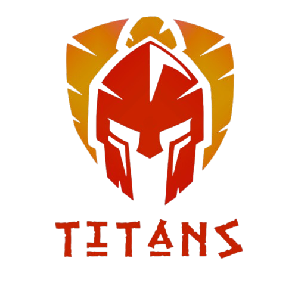

# Rover

  

---

## Sobre

Repositório destinado à documentação dos rovers da Equipe Titans: estudos, decisões e guias técnicos do projeto, em um só lugar.

## Projetos atuais

| Rover | Controlador | Destaques |
| :--- | :--- | :--- |
| [Bio-V2](pages/bioV2/index.md) | — | — |

## Estudos

Os estudos técnicos da equipe ficam na aba [Estudos](pages/estudos/index.md). O mais recente é o [Estudo da família YOLO](pages/estudos/yolo.md), que compara YOLOv5, YOLOv8 e YOLO11 e recomenda o modelo para o Protótipo 1.

## Integrantes

<!-- Uma linha por integrante. Foto: salve em docs/assets/integrantes/ e troque o campo por  -->

| Nome | Função | Foto |
| --- | --- | --- |
| <mark>[nome]</mark> | <mark>[função]</mark> | <mark>[foto]</mark> |
| <mark>[nome]</mark> | <mark>[função]</mark> | <mark>[foto]</mark> |
| <mark>[nome]</mark> | <mark>[função]</mark> | <mark>[foto]</mark> |

---

## Histórico de Versões

| Versão | Descrição | Autor(es) | Data de Produção | Revisor(es) |
| :----: | --------- | --------- | :--------------: | :--------------: |
| `0.1` | Criação da página inicial provisória | [Luiz](https://github.com/luizfaria1989) | 04/11/2026 | — |
| `0.2` | Inclusão da seção de integrantes e menu lateral | [Luiz](https://github.com/luizfaria1989) | 07/11/2026 | — |
| `1.0` | Migração para o MkDocs no padrão da equipe: projetos atuais, estudos e integrantes | [Luiz](https://github.com/luizfaria1989) | 11/11/2026 | — |
