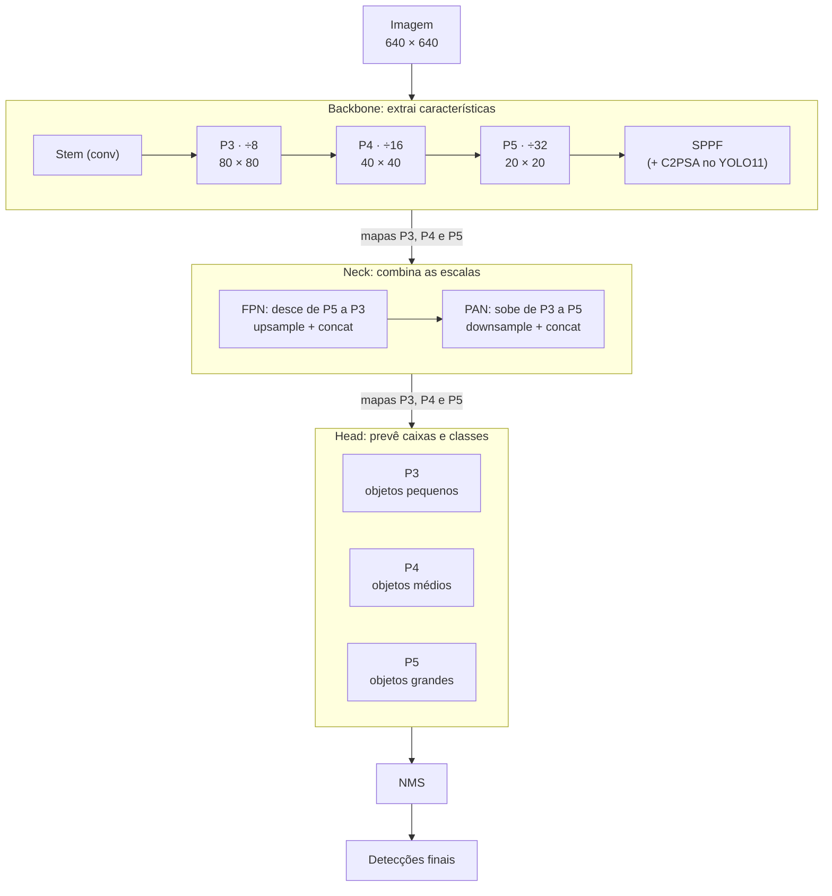
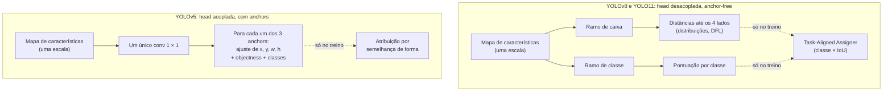
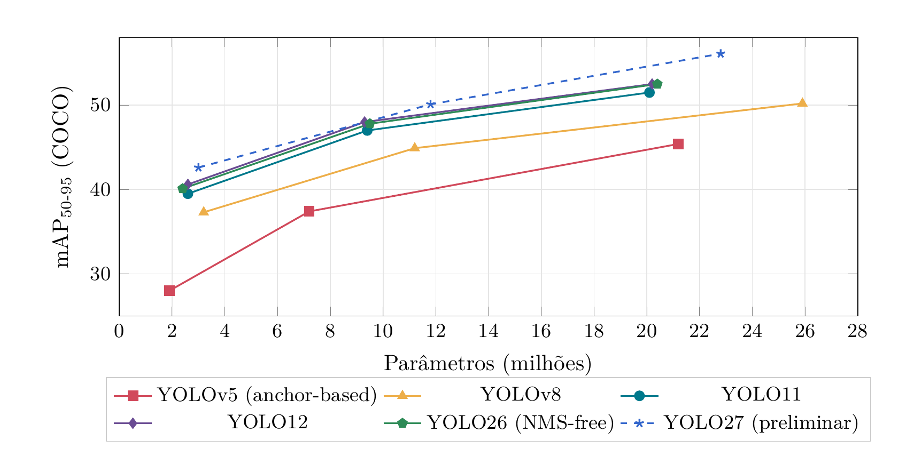

# Estudo da família YOLO

**Evolução YOLOv5 → YOLOv8 → YOLO11 e escolha do modelo para o P1**

- **Equipe:** Equipe Titans
- **Projeto:** Rover — Protótipo 1 (P1)
- **Responsáveis:** Luiz, Roberto, Thomas
- **Data:** 3 de novembro de 2026

---

## Sumário

- [1. Evolução arquitetural](#1-evolucao-arquitetural)
- [2. Conceitos de métricas e formato do dataset](#2-conceitos-de-metricas-e-formato-do-dataset)
- [3. Tabela comparativa](#3-tabela-comparativa)
- [4. Recomendação para o Protótipo 1](#4-recomendacao-para-o-prototipo-1)
- [5. Próximos passos](#5-proximos-passos)
- [Referências](#referencias)
- [Histórico de versões](#historico-de-versoes)

---

## 1. Evolução arquitetural

As três versões seguem a mesma divisão em três partes. O backbone extrai características da imagem em resoluções decrescentes. O neck combina mapas de escalas diferentes (caminhos FPN e PAN) para representar bem objetos pequenos e grandes. A head faz as previsões finais em três escalas (P3, P4 e P5, com redução de 8, 16 e 32 vezes). De uma versão para outra, o que mais muda é o bloco repetido do backbone e do neck (C3 → C2f → C3k2), o formato da head e a forma de escolher, no treino, quais previsões contam como acerto [[10]](#ref-10).



**Figura 1:** Estrutura comum ao YOLOv5, YOLOv8 e YOLO11. Cada etapa do backbone e do neck usa o bloco repetido da versão (C3, C2f ou C3k2). O neck recebe os mapas das três escalas: desce de P5 para P3 (FPN), levando contexto às escalas finas, e depois sobe de volta (PAN), levando detalhe às escalas grossas. Cada escala tem a sua head.

- **YOLOv5 → YOLOv8:** o bloco C2f concatena as saídas de todos os gargalos internos, não só a última, o que melhora o fluxo de gradiente. A head ganha ramos separados para classe e caixa, perde o objectness e abandona os anchors. As previsões positivas passam a ser escolhidas pelo Task-Aligned Assigner, que combina a pontuação da classe com o IoU da caixa prevista. A regressão ganha a DFL (*Distribution Focal Loss*), que trata cada lado da caixa como uma distribuição em vez de um número só [[11]](#ref-11).
- **YOLOv8 → YOLO11:** o C3k2 substitui o C2f. É uma variante cujo bloco interno pode ser um gargalo simples ou um bloco C3k, com tamanho de kernel configurável. Depois do SPPF entra o C2PSA, um bloco de atenção espacial que ajuda o modelo a focar nas regiões relevantes da imagem [[10]](#ref-10), [[17]](#ref-17). A head e a perda continuam as do YOLOv8. O resultado é um modelo mais enxuto: o YOLO11m tem 22% menos parâmetros que o YOLOv8m e mAP maior no COCO [[6]](#ref-6).

**Tabela 1:** Visão geral das mudanças por versão.

| Versão | Backbone / neck | Head | Loss / atribuição | Pós-proc. |
| --- | --- | --- | --- | --- |
| YOLOv5 (2020) | CSPDarknet com C3; stem conv 6 × 6; SPPF; neck PANet | Acoplada, baseada em anchors (3/célula), com *objectness* | BCE (obj + cls) + CIoU; atribuição por razão de forma | NMS |
| YOLOv8 (2023) | Blocos C2f; stem conv 3 × 3; SPPF; neck PANet com C2f | Desacoplada, anchor-free, sem *objectness* | BCE + CIoU + DFL; Task-Aligned Assigner | NMS |
| YOLO11 (2024) | Blocos C3k2; SPPF + C2PSA (atenção espacial) | Desacoplada, anchor-free; ramo de classe com convs *depthwise* | Igual ao YOLOv8 | NMS |
| YOLO12 (2025) | C3k2 nos estágios iniciais; A2C2f (*Area Attention* + R-ELAN) em P4/P5 e no neck | Igual ao YOLO11 | Igual ao YOLOv8 | NMS |
| YOLO26 (2026) | Igual ao YOLO11 (C3k2, SPPF, C2PSA) | Anchor-free, sem DFL; head one-to-one (end-to-end) | ProgLoss + STAL; otimizador MuSGD | NMS-free |
| YOLO27 (2026\*) | n/s: CNN simplificada, prediz em 2 escalas\*(não 3); m: backbone estilo YOLO26 + decoder transformer | n/s: one-to-many + one-to-one opcional; m: baseada em queries | Não divulgada; n/s têm ramo de alinhamento de *foreground* só no treino | n/s: NMS‡<br>m: NMS-free |

<div class="nota-tabela" markdown>

\* Anunciado em 13/09/2026; ainda sem pesos, sem suporte no pacote `ultralytics` e sem data de lançamento. ‡ NMS por padrão; NMS-free com `nms=False`.

</div>

### 1.1 Da detecção por anchors à head anchor-free

**Como o YOLOv5 usa anchors.** Cada célula da grade, em cada escala, recebe três caixas de referência com proporções fixas, os *anchors*. A rede não prevê a caixa diretamente: prevê ajustes de posição e de escala sobre cada anchor, mais a probabilidade de haver um objeto ali (*objectness*). No treino, um objeto anotado só é atribuído aos anchors cuja forma se parece com a dele.

**Problemas dessa abordagem:**

- Os anchors são hiperparâmetros ligados ao dataset. Os do COCO não necessariamente servem para os objetos do ERC e precisam ser recalculados por agrupamento (k-means) das caixas anotadas.
- Várias previsões por célula geram muito mais caixas candidatas, o que pesa no NMS.
- A atribuição por semelhança de forma é fixa e ignora a qualidade real da previsão.

**Como funciona a head anchor-free do YOLOv8 e do YOLO11.** Cada ponto da grade prevê diretamente as distâncias até os quatro lados da caixa (esquerda, topo, direita e base), cada uma como uma distribuição treinada com DFL. Não há caixas de referência nem ramo de *objectness*, e as previsões positivas são escolhidas dinamicamente pelo Task-Aligned Assigner [[11]](#ref-11).



**Figura 2:** O que a head prevê em cada ponto da grade, em uma escala. A atribuição (linha tracejada) só acontece no treino e decide quais previsões contam como positivas.

**Vantagens para o rover:**

1. **Menos hiperparâmetros:** não é preciso recalcular anchors a cada dataset novo.
2. **Melhor generalização** para objetos com formas que não aparecem no COCO, como sondas, ferramentas e componentes de painel.
3. **Menos previsões por imagem:** NMS mais rápido e pós-processamento mais simples de portar para ONNX, NCNN ou TensorRT.
4. **Treino mais estável,** porque a escolha dos positivos acompanha a qualidade das previsões.

**Evidência numérica.** A Ultralytics publicou o YOLOv5u, que mantém o backbone e o neck do YOLOv5, mas troca a head pela head anchor-free e sem *objectness* do YOLOv8 [[12]](#ref-12).

**Tabela 2:** Efeito da head anchor-free no YOLOv5s (COCO val2017, entrada 640 × 640).

| Modelo | Head | Params (M) | GFLOPs | mAP₅₀₋₉₅ |
| --- | --- | ---: | ---: | ---: |
| YOLOv5s [[1]](#ref-1) | Baseada em anchors | 7,2 | 16,5 | 37,4 |
| YOLOv5su [[12]](#ref-12) | Anchor-free | 9,1 | 24,0 | 43,0 |

!!! note
    A troca de head veio junto com o pipeline de treino do pacote `ultralytics`, então parte dos +5,6 pontos também vem do treino. Mesmo assim, é a comparação mais direta do efeito da head anchor-free, e ela custa cerca de 45% a mais de FLOPs.

### 1.2 Trade-offs entre as variantes nano, small e medium

**Tabela 3:** Variantes n/s/m (COCO val2017, entrada 640 × 640). Latências em ms. Fontes: [[1]](#ref-1), [[2]](#ref-2), [[3]](#ref-3), [[4]](#ref-4), [[5]](#ref-5), [[6]](#ref-6).

| Versão | Modelo | Params (M) | GFLOPs | mAP₅₀₋₉₅ | CPU | GPU | No rover |
| --- | --- | ---: | ---: | ---: | ---: | ---: | ---: |
| **YOLOv5**ᵃ | YOLOv5n | 1,9 | 4,5 | 28,0 | 45 | 6,3 | <mark>[–]</mark> |
| | YOLOv5s | 7,2 | 16,5 | 37,4 | 98 | 6,4 | <mark>[–]</mark> |
| | YOLOv5m | 21,2 | 49,0 | 45,4 | 224 | 8,2 | <mark>[–]</mark> |
| **YOLOv8**ᵇ | YOLOv8n | 3,2 | 8,7 | 37,3 | 80,4 | 0,99 | <mark>[–]</mark> |
| | YOLOv8s | 11,2 | 28,6 | 44,9 | 128,4 | 1,20 | <mark>[–]</mark> |
| | YOLOv8m | 25,9 | 78,9 | 50,2 | 234,7 | 1,83 | <mark>[–]</mark> |
| **YOLO11**ᶜ | YOLO11n | 2,6 | 6,5 | 39,5 | 56,1 | 1,5 | <mark>[–]</mark> |
| | YOLO11s | 9,4 | 21,6 | 47,0 | 90,0 | 2,5 | <mark>[–]</mark> |
| | YOLO11m | 20,1 | 68,1 | 51,5 | 183,2 | 4,7 | <mark>[–]</mark> |
| **YOLO12**ᵈ | YOLO12n | 2,6 | 7,5 | 40,6 | – | 1,64 | <mark>[–]</mark> |
| | YOLO12s | 9,3 | 23,3 | 48,0 | – | 2,61 | <mark>[–]</mark> |
| | YOLO12m | 20,2 | 70,7 | 52,5 | – | 4,86 | <mark>[–]</mark> |
| **YOLO26**ᵉ | YOLO26n | 2,4 | 5,5 | 40,1 | 38,9 | 1,7 | <mark>[–]</mark> |
| | YOLO26s | 9,5 | 20,9 | 47,8 | 87,2 | 2,5 | <mark>[–]</mark> |
| | YOLO26m | 20,4 | 68,4 | 52,5 | 220,0 | 4,7 | <mark>[–]</mark> |
| **YOLO27**ᶠ | YOLO27n | 3,0 | 7,2 | 42,6 | 16,1 | 0,44 | <mark>[–]</mark> |
| | YOLO27s | 11,8 | 28,2 | 50,1 | 33,2 | 0,64 | <mark>[–]</mark> |
| | YOLO27m | 22,8 | 65,0 | 56,1 | 74,8 | 1,01 | <mark>[–]</mark> |

<div class="nota-tabela" markdown>

- ᵃ YOLOv5 v7.0 (anchor-based): CPU PyTorch, GPU NVIDIA V100 (batch 1).
- ᵇ YOLOv8: CPU ONNX, GPU NVIDIA A100 TensorRT.
- ᶜ YOLO11: CPU ONNX, GPU NVIDIA T4 TensorRT 10.
- ᵈ YOLO12: GPU NVIDIA T4 TensorRT FP16; a documentação não publica latência em CPU.
- ᵉ YOLO26: CPU ONNX, GPU NVIDIA T4 TensorRT 10, modo NMS-free; mAP do modo end-to-end (com a head one-to-many + NMS: 40,9 / 48,6 / 53,1); params e FLOPs do modelo fundido.
- ᶠ YOLO27 (**preliminar, não lançado**): CPU ONNX, GPU NVIDIA RTX PRO 6000 TensorRT 11; params e FLOPs do modelo fundido. A Ultralytics diz que o YOLO27n/s tem velocidade praticamente igual à do YOLO26n/s, então a CPU diferente deve explicar a latência bem menor.

As latências de YOLO11, YOLO12 e YOLO26 (T4) são comparáveis entre si; as demais vêm de outras máquinas e só se comparam entre tamanhos da mesma versão. A coluna “No rover” deve ser preenchida com `yolo benchmark` [[7]](#ref-7) executado no hardware real do rover.

</div>

<div align="center" markdown>
{ width="900" }
</div>

**Figura 3:** Precisão versus tamanho do modelo. Em cada curva, os três pontos são as variantes n, s e m, da esquerda para a direita. YOLO11, YOLO12 e YOLO26 ficam acima e à esquerda do YOLOv5 e do YOLOv8: mais mAP com menos parâmetros. A curva tracejada do YOLO27 usa dados preliminares de um modelo ainda não lançado.

**Latência de referência no Raspberry Pi 5.** Enquanto a coluna “No rover” não é medida, os benchmarks oficiais da Ultralytics no Raspberry Pi 5 servem de referência. A Ultralytics só publica as variantes n e s, porque considera as maiores pesadas demais para o Pi [[14]](#ref-14).

**Tabela 4:** Inferência no Raspberry Pi 5, só CPU, FP32, entrada 640 × 640, formato NCNN. FPS calculados como 1000 / ms.

| Modelo | Inferência (ms) | FPS (só inferência) | Versão do benchmark |
| --- | ---: | ---: | --- |
| YOLO11n | 93,9 | 10,6 | `ultralytics` 8.3.39 |
| YOLO11s | 197,4 | 5,1 | `ultralytics` 8.3.39 |
| YOLO26n | 67,0 | 14,9 | `ultralytics` 8.4.108 |
| YOLO26s | 172,9 | 5,8 | `ultralytics` 8.4.108 |

!!! warning
    Esses tempos não incluem captura da câmera, pré-processamento nem pós-processamento. Em uso real, conte com algo próximo de metade desses FPS (estimativa) até medir no hardware do rover.

**Leitura dos trade-offs:**

- **n → s:** no YOLO11, 3,6× mais parâmetros e 3,3× mais FLOPs por +7,5 pontos de mAP. No Pi 5, a latência dobra (Tabela 4).
- **s → m:** 2,1× mais parâmetros e 3,2× mais FLOPs por só +4,5 pontos. O YOLOv8 repete o padrão (+7,6 e depois +5,3). Os ganhos diminuem a cada degrau.
- **No rover,** quem decide é a latência no hardware real. No Pi 5 só com CPU, o *medium* fica fora, o *small* fica abaixo de tempo real e o *nano* é o único que se aproxima dele.
- **Entre gerações,** o YOLO11n supera o YOLOv5s em mAP (39,5 contra 37,4) com menos da metade dos FLOPs. Trocar de geração rende mais do que subir de tamanho numa versão antiga.

## 2. Conceitos de métricas e formato do dataset

### 2.1 Métricas aplicadas ao cenário do rover

Uma detecção é verdadeiro positivo (TP) quando a classe está correta e a sobreposição com a caixa real ultrapassa um limiar de IoU (*Intersection over Union*):

$$
\text{IoU} = \frac{|B_{\text{pred}} \cap B_{\text{real}}|}{|B_{\text{pred}} \cup B_{\text{real}}|}
$$

Caso contrário, é falso positivo (FP). Um objeto real que não foi detectado é um falso negativo (FN). Classes do rover: <mark>[ex.: obstáculo, rocha, marcador ArUco, ferramenta]</mark>. As definições seguem o guia de métricas da Ultralytics [[8]](#ref-8) e o protocolo do COCO [[9]](#ref-9).

**Tabela 5:** Métricas de detecção. $\text{AP}_c$ é a *Average Precision* da classe $c$ e $N$ é o número de classes.

| Métrica | Definição | Interpretação no rover |
| --- | :---: | --- |
| Precision | $\dfrac{TP}{TP + FP}$ | Das detecções que o rover fez, quantas eram reais. Precision baixa gera *alarmes falsos*: o rover desvia ou para por obstáculos que não existem e perde tempo de missão. |
| Recall | $\dfrac{TP}{TP + FN}$ | Dos objetos que estavam na cena, quantos o rover encontrou. Recall baixo significa *obstáculo não visto* (risco de colisão) ou alvo da missão perdido. Para segurança, é a métrica mais crítica. |
| mAP₅₀ | $\dfrac{1}{N}\sum_{c=1}^{N} AP_c^{\,\text{IoU}=0{,}5}$ | Média, entre as classes, da área sob a curva Precision×Recall com IoU ≥ 0,5. Mede se o rover *encontra e identifica* os objetos, aceitando caixas aproximadas. Basta para decisões do tipo “há um obstáculo à frente”. |
| mAP₅₀₋₉₅ | $\dfrac{1}{10}\sum_{t\in\{0{,}50,\dots,0{,}95\}} \text{mAP}_t$ | Média do mAP em 10 limiares de IoU (de 0,50 a 0,95, passo 0,05). Premia caixas *bem ajustadas*. Importa quando a posição exata da caixa alimenta outra etapa, como estimar a distância de um objeto, alinhar o rover a um alvo ou agarrar com o braço. |

**Observação prática:** o limiar de confiança (`conf`) usado na inferência move o ponto de operação. Um `conf` baixo aumenta o recall e reduz a precision; um `conf` alto faz o contrário. Para o rover, sugere-se escolher o `conf` pela curva P–R de validação, priorizando recall nas classes de obstáculo. Meta do P1: mAP₅₀ ≥ <mark>[definir]</mark> e recall (obstáculos) ≥ <mark>[definir]</mark>.

### 2.2 Formato de anotação exigido pela Ultralytics

Cada imagem do dataset tem um arquivo `.txt` com o mesmo nome. Imagens sem objetos não precisam de arquivo. Cada linha descreve um objeto no formato `class x_center y_center width height`, com as coordenadas normalizadas entre 0 e 1 [[13]](#ref-13). As pastas `images/` e `labels/` espelham uma à outra, e um arquivo YAML indica onde ficam os conjuntos de treino e validação e quais são os nomes das classes.

```text
datasets/rover/
├── data.yaml
├── images/
│   ├── train/   marsyard_0042.jpg ...
│   └── val/
└── labels/
    ├── train/   marsyard_0042.txt ...
    └── val/
```

**Tabela 6:** Os cinco valores de cada linha do arquivo de anotação.

| Campo | Significado |
| --- | --- |
| `class` | Índice inteiro da classe, começando em 0, na ordem definida em `names` no YAML. |
| `x_center` | Coordenada horizontal do centro da caixa, dividida pela largura da imagem. |
| `y_center` | Coordenada vertical do centro da caixa, dividida pela altura da imagem. |
| `width` | Largura da caixa, dividida pela largura da imagem. |
| `height` | Altura da caixa, dividida pela altura da imagem. |

A origem é o canto superior esquerdo da imagem. Como os valores são normalizados, a mesma anotação continua válida quando a imagem é redimensionada para 640 ou 320 px no treino.

**Exemplo.** Uma foto de 1280 × 720 px com um objeto da classe 0 entre os pixels (500, 300) e (620, 420):

$$
x_c = \frac{560}{1280} = 0{,}4375 \qquad
y_c = \frac{360}{720} = 0{,}5 \qquad
w = \frac{120}{1280} = 0{,}09375 \qquad
h = \frac{120}{720} \approx 0{,}1667
$$

```text title="labels/train/marsyard_0042.txt"
0 0.437500 0.500000 0.093750 0.166667
```

```yaml title="data.yaml"
path: datasets/rover
train: images/train
val: images/val
names:            # classes ilustrativas: usar as definidas na seção 2.1
  0: obstaculo
  1: marcador
```

!!! tip
    Incluir no treino algumas imagens do terreno sem nenhum objeto (sem arquivo `.txt`) ensina o modelo a não confundir rochas e sombras com alvos, o que melhora a precision.

## 3. Tabela comparativa

**Tabela 7:** Variantes *small* das três versões estudadas (COCO val2017, entrada 640 × 640). Mesmas fontes da Tabela 3.

| Modelo | Params (M) / GFLOPs / mAP₅₀₋₉₅ | Prós | Contras |
| --- | :---: | --- | --- |
| YOLOv5s | 7,2 / 16,5 / 37,4 | Menos FLOPs dos três.<br>Muito maduro, com grande base de exemplos e tutoriais. | Anchors precisam ser recalculados para o dataset.<br>mAP 9,6 pontos abaixo do YOLO11s.<br>Vive num repositório separado, com scripts próprios de treino e exportação. |
| YOLOv8s | 11,2 / 28,6 / 44,9 | Head anchor-free e desacoplada.<br>Retém praticamente toda a precisão na quantização INT8ᵃ.<br>Suporte amplo de exportação. | O mais pesado dos três em parâmetros e FLOPs. |
| YOLO11s | 9,4 / 21,6 / 47,0 | Maior mAP com menos parâmetros e FLOPs que o YOLOv8s.<br>Mesma API e mesmos comandos de exportação do YOLOv8. | O bloco de atenção C2PSA é mais sensível à quantização INT8ᵃ. |

<div class="nota-tabela" markdown>

- ᵃ No acelerador Hailo-8L, após a quantização INT8, o YOLOv8n retém cerca de 100% do mAP₅₀ e o YOLO11n, cerca de 96%. A Ultralytics atribui a diferença aos blocos de atenção do backbone [[15]](#ref-15). Só importa se o rover usar um acelerador que exija INT8.

</div>

Os outros modelos da Tabela 3 ficam fora do escopo pedido, mas valem uma nota. O YOLO12s tem mAP um pouco maior, porém a Ultralytics só publica pesos pré-treinados de detecção e recomenda YOLO11 ou YOLO26 para produção [[3]](#ref-3). O YOLO26s dispensa o NMS (head end-to-end), o que simplifica a exportação, e é o candidato natural para o P2 (seção 4.3).

## 4. Recomendação para o Protótipo 1

### 4.1 Premissas

- **Hardware:** <mark>[confirmar: Raspberry Pi 5 (8 GB), só CPU]</mark>. A recomendação abaixo assume esse cenário; a Tabela 8 mostra o que muda com outro hardware.
- **Taxa de quadros:** <mark>[confirmar: ≥ 5 FPS de ponta a ponta na busca]</mark>. A 0,5 m/s, um rover que processa 5 quadros por segundo anda 10 cm entre um quadro e outro, o que basta para busca e navegação. O controle do braço em malha fechada se beneficia de 10 FPS ou mais.

### 4.2 Variante recomendada

!!! note "Recomendação"
    **YOLO11n**, ajustado (*fine-tuning*) a partir de `yolo11n.pt`, com entrada de 640 × 640, exportado para **NCNN** para rodar no Raspberry Pi 5 e para **ONNX** como formato portátil.

**Justificativa:**

1. **Hardware e FPS:** no Pi 5, o YOLO11n em NCNN leva 93,9 ms por imagem (10,6 FPS só de inferência), contra 197,4 ms do YOLO11s (5,1 FPS) (Tabela 4). Contando captura e pós-processamento, o *small* fica abaixo da meta de 5 FPS mesmo no melhor caso. O *nano* fica perto da meta e ainda tem duas margens: reduzir a entrada para 416 ou 320 px ou passar para o YOLO26n (seção 4.3).
2. **Precisão:** entre as três versões estudadas, o YOLO11n tem o maior mAP na variante nano (39,5 contra 37,3 do YOLOv8n e 28,0 do YOLOv5n), com custo menor que o do YOLOv8n (6,5 contra 8,7 GFLOPs).
3. **Exportação:** no pacote `ultralytics`, cada formato é um único comando: `format=ncnn`, `format=onnx` ou `format=engine` para TensorRT [[18]](#ref-18). O YOLOv5 original exige o repositório antigo e outro script. O TensorRT só roda em GPU NVIDIA, então só entra se o rover usar uma Jetson.
4. **Continuidade:** o YOLO11 fica no mesmo ecossistema do YOLOv8 e do YOLO26, então trocar de modelo depois não exige reescrever o pipeline.

```bash
# treino (no PC ou no Colab)
yolo detect train model=yolo11n.pt data=data.yaml imgsz=640 epochs=100

# exportação
yolo export model=best.pt format=ncnn imgsz=640   # para rodar no Pi 5
yolo export model=best.pt format=onnx imgsz=640   # formato portátil

# medição no hardware do rover (preenche a coluna "No rover" da Tabela 3)
yolo benchmark model=best.pt data=data.yaml imgsz=640 device=cpu
```

### 4.3 Se o hardware for outro

**Tabela 8:** Recomendação conforme o hardware embarcado.

| Hardware | Modelo e formato | Motivo |
| --- | --- | --- |
| Raspberry Pi 5, só CPU | YOLO11n, NCNN | Recomendação da seção 4.2. |
| Raspberry Pi 5 + AI HAT+ (Hailo) | YOLOv8s, HEF | O YOLOv8 retém mais precisão na quantização INT8 desse acelerador, e o acelerador torna o *small* viável em tempo real. A exportação (`format=hailo`) precisa ser feita num PC com Linux x86_64 [[15]](#ref-15). |
| NVIDIA Jetson (Orin Nano/NX) | YOLO11s, TensorRT FP16 | Aqui o TensorRT entra de fato (`format=engine half=True`). Como referência, o YOLO11s roda a 7,91 ms em TensorRT FP16 numa Jetson Orin NX 16 GB [[16]](#ref-16). |

**Alternativa a medir no P2:** o YOLO26n, que dispensa o NMS e mediu 67,0 ms em NCNN no Pi 5 (Tabela 4). Fica fora do escopo desta tarefa, mas vale um teste A/B contra o YOLO11n assim que houver dataset próprio.

## 5. Próximos passos

1. Confirmar o hardware do P1 e se haverá acelerador.
2. Definir as classes do dataset e as metas de mAP₅₀ e recall da seção 2.1.
3. Montar o dataset no formato da seção 2.2, com fotos sob sol, sombra e poeira e imagens de terreno sem objetos.
4. Rodar `yolo benchmark` no hardware real e preencher a coluna “No rover” da Tabela 3.
5. Confirmar com a equipe a licença AGPL-3.0 do pacote `ultralytics`, que exige publicar o código se o software for distribuído.

## Referências

1. <span id="ref-1"></span>G. Jocher, *YOLOv5 by Ultralytics*, 2020. doi: [10.5281/zenodo.3908559](https://doi.org/10.5281/zenodo.3908559). Acesso em 2 de nov. de 2026. Endereço: <https://github.com/ultralytics/yolov5>.
2. <span id="ref-2"></span>Ultralytics. “Ultralytics YOLO26,” *Ultralytics Docs*, acesso em 3 de nov. de 2026. Endereço: <https://docs.ultralytics.com/models/yolo26/>.
3. <span id="ref-3"></span>Ultralytics. “YOLO12: Attention-Centric Object Detection,” *Ultralytics Docs*, acesso em 3 de nov. de 2026. Endereço: <https://docs.ultralytics.com/models/yolo12/>.
4. <span id="ref-4"></span>Ultralytics. “Ultralytics YOLO27,” *Ultralytics Docs*, acesso em 3 de nov. de 2026. Endereço: <https://docs.ultralytics.com/models/yolo27/>.
5. <span id="ref-5"></span>Ultralytics. “YOLOv8,” *Ultralytics Docs*, acesso em 2 de nov. de 2026. Endereço: <https://docs.ultralytics.com/models/yolov8/>.
6. <span id="ref-6"></span>Ultralytics. “YOLO11,” *Ultralytics Docs*, acesso em 2 de nov. de 2026. Endereço: <https://docs.ultralytics.com/models/yolo11/>.
7. <span id="ref-7"></span>Ultralytics. “Model Benchmarking with Ultralytics YOLO,” *Ultralytics Docs*, acesso em 2 de nov. de 2026. Endereço: <https://docs.ultralytics.com/modes/benchmark/>.
8. <span id="ref-8"></span>Ultralytics. “Performance Metrics Deep Dive,” *Ultralytics Docs*, acesso em 2 de nov. de 2026. Endereço: <https://docs.ultralytics.com/guides/yolo-performance-metrics/>.
9. <span id="ref-9"></span>T.-Y. Lin et al., “Microsoft COCO: Common Objects in Context,” em *European Conference on Computer Vision (ECCV)*, 2014, pp. 740–755.
10. <span id="ref-10"></span>Ultralytics. “YOLO Architecture Explained: From YOLOv3 to YOLO26,” *Ultralytics Docs*, acesso em 8 de nov. de 2026. Endereço: <https://docs.ultralytics.com/guides/yolo-architecture/>.
11. <span id="ref-11"></span>OpenMMLab. “Algorithm principles and implementation with YOLOv8,” *MMYOLO Docs*, acesso em 8 de nov. de 2026. Endereço: <https://mmyolo.readthedocs.io/en/dev/recommended_topics/algorithm_descriptions/yolov8_description.html>.
12. <span id="ref-12"></span>Ultralytics. “Ultralytics YOLOv5,” *Ultralytics Docs*, acesso em 8 de nov. de 2026. Endereço: <https://docs.ultralytics.com/models/yolov5/>.
13. <span id="ref-13"></span>Ultralytics. “Object Detection Datasets Overview,” *Ultralytics Docs*, acesso em 8 de nov. de 2026. Endereço: <https://docs.ultralytics.com/datasets/detect/>.
14. <span id="ref-14"></span>Ultralytics. “Quick Start Guide: Raspberry Pi with Ultralytics YOLO,” *Ultralytics Docs*, acesso em 8 de nov. de 2026. Endereço: <https://docs.ultralytics.com/guides/raspberry-pi/>.
15. <span id="ref-15"></span>Ultralytics. “Hailo Export for Ultralytics YOLO Models,” *Ultralytics Docs*, acesso em 8 de nov. de 2026. Endereço: <https://docs.ultralytics.com/integrations/hailo/>.
16. <span id="ref-16"></span>Ultralytics. “Ultralytics YOLO11 on NVIDIA Jetson using DeepStream SDK and TensorRT,” *Ultralytics Docs*, acesso em 8 de nov. de 2026. Endereço: <https://docs.ultralytics.com/guides/deepstream-nvidia-jetson/>.
17. <span id="ref-17"></span>R. Khanam e M. Hussain, “YOLOv11: An Overview of the Key Architectural Enhancements,” arXiv:2410.17725, 2024. Endereço: <https://arxiv.org/abs/2410.17725>.
18. <span id="ref-18"></span>Ultralytics. “Model Export with Ultralytics YOLO,” *Ultralytics Docs*, acesso em 8 de nov. de 2026. Endereço: <https://docs.ultralytics.com/modes/export/>.

---

## Histórico de Versões

| Versão | Descrição | Autor(es) | Data de Produção | Revisor(es) |
| :----: | --------- | --------- | :--------------: | :--------------: |
| `0.1` | Versão inicial do estudo, com tabelas comparativas. | [Luiz](https://github.com/luizfaria1989) | 04/11/2026 | — |
| `0.2` | Inclusão da transição para a head anchor-free, latência no Raspberry Pi 5, formato do dataset, tabela comparativa, recomendação para o P1 e próximos passos. | [Luiz](https://github.com/luizfaria1989) | 08/11/2026 | — |
| `0.3` | Inclusão dos diagramas da arquitetura e da head (Figuras 1 e 2). | [Luiz](https://github.com/luizfaria1989) | 08/11/2026 | — |
| `0.4` | Migração da documentação em Astro para o MkDocs | [Luiz](https://github.com/luizfaria1989) | 11/11/2026 | — |
